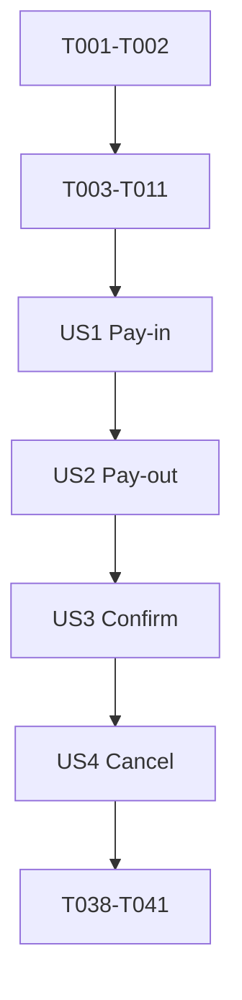

# Tasks: Partner Payments

**Input**: Design documents from `/specs/005-partner-payments/`

**Prerequisites**: `plan.md`, `spec.md`, `research.md`, `data-model.md`, and `contracts/`

**Testing**: Test-first tasks are required by the Nox constitution. Write each failing test before the production change it verifies; API integration tests use real PostgreSQL and Keycloak plus the approved WireMock payment-core mock.

**Organization**: Tasks are grouped by the four independently demonstrable user stories in `spec.md`.

## Phase 1: Setup (Shared Infrastructure)

**Purpose**: Resolve the external integration gates and add the selected resilience dependency.

- [X] T001 Confirm project-owner approval of the WireMock 3.13.2 container approach, then confirm payment-core payment-method selection, cancel path/request/response, and duplicate/timeout behavior for confirm and cancel; record approved contracts in `specs/005-partner-payments/research.md` and `specs/005-partner-payments/contracts/payment-core.md` before any dependent implementation
- [X] T002 [P] Add `io.github.resilience4j:resilience4j-circuitbreaker:2.4.0` to `pom.xml`

---

## Phase 2: Foundational (Blocking Prerequisites)

**Purpose**: Establish shared payment configuration, lifecycle, persistence, OAuth2 client settings, and test infrastructure before story work.

**⚠️ CRITICAL**: Complete T001 before any payment-core-dependent implementation. Complete this phase before starting user stories.

- [X] T003 [P] Write failing configuration binding tests for partner payment method, payment-core base URL, OAuth2 client registration, and positive connect/read timeout properties in `src/test/java/com/nox/infrastructure/config/PartnerPaymentPropertiesTest.java`
- [X] T004 [P] Write failing payment aggregate tests for type, positive decimal amount, configured bounds, account snapshot, allowed status values, and legal payment state transitions in `src/test/java/com/nox/domain/payment/PaymentTest.java`
- [X] T005 [P] Write failing Liquibase/PostgreSQL integration tests for payment/account/limit tables, foreign keys, uniqueness, and inclusive limit boundaries in `src/test/java/com/nox/integration/PaymentPersistenceIT.java`
- [X] T006 [P] Implement and validate the payment-core and payment-method configuration properties in `src/main/java/com/nox/infrastructure/config/PartnerPaymentProperties.java`, `src/main/resources/application.yaml`, `src/main/resources/application-dev.yaml`, `src/main/resources/application-stage.yaml`, and `src/main/resources/application-prod.yaml` (credentials and URLs remain environment-injected). _Revised 2026-10-31: the payment-core connection settings moved to the adapter-owned `adapter/out/paymentcore/PaymentCoreProperties.java` (constitution 1.7.0, Principle X); `PartnerPaymentProperties` keeps only the payment methods._
- [X] T007 [P] Implement framework-free payment type, money/limit value objects, payment lifecycle statuses, and aggregate rules in `src/main/java/com/nox/domain/payment/PaymentType.java`, `src/main/java/com/nox/domain/payment/Money.java`, `src/main/java/com/nox/domain/payment/PaymentStatus.java`, and `src/main/java/com/nox/domain/payment/Payment.java`; status set: `INITIATING`, `AWAITING_OTP`, `CONFIRMING`, `CANCELLING`, `CONFIRMED`, `CANCELLED`, `FAILED`, `EXPIRED`, `INITIATION_UNKNOWN`, `CONFIRMATION_UNKNOWN`, `CANCELLATION_UNKNOWN`
- [X] T008 [P] Create Liquibase changesets `src/main/resources/db/changelog/changes/009-partner-payment-account.yaml`, `010-partner-payment-limit.yaml`, and `011-payment.yaml`, include them in `src/main/resources/db/changelog/db.changelog-master.yaml`, and add rollback definitions. Preserve these model constraints: Partner Payment Account `partnerId` is the primary key and FK to `partner.id` (one active record per partner); `providerUserId` and `accountId` are required strings; `updatedAt` is required. Partner Payment Limit has composite primary key `(partnerId, type, currencyCode)`; `type` is `PAYIN` or `PAYOUT`; `currencyCode` is required; `enabled` is Boolean; `minimumAmount` is required, greater than zero, and inclusive; `maximumAmount` is required, greater than or equal to minimum, and inclusive. Payment `id` is the UUID primary key; `paymentCoreId` is required once returned by payment-core and unique when present; `partnerId` and `userLinkId` are foreign keys; `providerUserIdSnapshot` and `accountIdSnapshot` retain the selected account identity; `(partnerId, idempotencyKey)` is unique; `requestFingerprint` is the digest of normalized request fields; type is `PAYIN` or `PAYOUT`; `paymentMethod` is the configured method value used for the type; amount is positive and within configured bounds; currency is enabled for partner and type; description, fee, and processor dates are nullable; preserve the complete status set from T007
- [X] T009 [P] Implement JPA entities, repositories, and outbound persistence adapters for partner payment accounts, limits, and payments in `src/main/java/com/nox/adapter/out/persistence/payment/` after T008
- [X] T010 Register payment-core OAuth2 client credentials without API-key authentication and configure bounded HTTP timeouts in `src/main/resources/application.yaml` and environment-specific YAML files after T006; circuit-breaker behavior is covered with the adapter tests before its implementation
- [X] T011 [P] Extend shared Testcontainers properties and WireMock payment-core/token stubs in `src/test/java/com/nox/integration/support/InfrastructureContainers.java` and `src/test/java/com/nox/integration/support/PaymentCoreWireMockSupport.java` after T001; use placeholder credentials only

**Checkpoint**: Payment domain, configuration, schema, authentication client, and approved mock are ready; story work can begin.

---

## Phase 3: User Story 1 - Initiate a Pay-In (Priority: P1) 🎯 MVP

**Goal**: Allow an authenticated partner to initialize a pay-in using either NOX `userLinkId` or its stored `partner_external_id` (`externalLinkId`), with idempotency and configured limits.

**Independent Test**: In a full HTTP integration test, initialize a valid PAYIN through each identifier route; verify one payment-core call, the response envelope and required payment fields, and replay behavior. An invalid link, currency, amount, or caller must not create a payment.

### Tests for User Story 1

> Write and run these tests first; verify each fails for the expected missing behavior.

- [X] T012 [P] [US1] Write failing pay-in use-case tests for connected-link ownership, configured pay-in method, partner/type/currency limits, active account snapshot, idempotent replay, and mismatched same-key payload in `src/test/java/com/nox/application/service/payment/InitiatePaymentServiceTest.java`
- [X] T013 [P] [US1] Write failing payment-core PAYIN adapter tests for OAuth2 bearer, absence of API key, request mapping, stable upstream idempotency key, response/fee mapping, bounded timeout, and open-circuit rejection in `src/test/java/com/nox/adapter/out/paymentcore/PaymentCoreAdapterTest.java`
- [X] T014 [P] [US1] Write failing full-path PAYIN tests for both `POST /api/v1/user-partner-links/{userLinkId}/payments` and `POST /api/v1/user-partner-links/by-external-id/{externalLinkId}/payments` in `src/test/java/com/nox/integration/PartnerPaymentPayinIT.java`; cover Keycloak role, partner scoping, connected status, amount/currency limits, idempotency, standard envelope, and problem responses against PostgreSQL and WireMock

### Implementation for User Story 1

- [X] T015 [US1] Implement the payment processor output port, PAYIN request/response mapping, bounded timeout, circuit breaker, and safe retry wrapper in `src/main/java/com/nox/application/port/out/payment/PaymentProcessorPort.java` and `src/main/java/com/nox/adapter/out/paymentcore/PaymentCoreAdapter.java`; map payment-core `referenceNumber` from partner `transactionReference`, preserve its processor payment ID, returned money, fee, status, and timestamps, and retry initialization only with the same durable idempotency key
- [X] T016 [US1] Implement pay-in initiation orchestration in `src/main/java/com/nox/application/service/payment/InitiatePaymentService.java`; resolve the authenticated partner and connected link, resolve `externalLinkId` only through the partner-scoped latest-established-link lookup, apply the configured payment method and inclusive limit row, reserve `(partnerId, idempotencyKey)`, fingerprint normalized input, snapshot provider/account IDs, and use the durable payment UUID as the stable payment-core idempotency key
- [X] T017 [US1] Add pay-in DTO validation and both link-identifier initiation routes in `src/main/java/com/nox/adapter/in/web/payment/PartnerPaymentController.java` and `src/main/java/com/nox/adapter/in/web/payment/PaymentInitiationRequest.java`; return `201` for first creation and the existing payment on an identical replay, use the standard `{data, meta}` envelope, and never accept partner/account/user IDs from the body
- [X] T018 [US1] Map pay-in validation, idempotency conflict, and payment-core unavailable outcomes to documented problem responses in `src/main/java/com/nox/adapter/in/web/error/ProblemType.java` and `src/main/java/com/nox/adapter/in/web/error/GlobalExceptionHandler.java`; ensure logs omit tokens, OTPs, account IDs, and amounts

**Checkpoint**: PAYIN initiation works via both identifiers and is independently testable.

---

## Phase 4: User Story 2 - Initiate a Pay-Out (Priority: P1)

**Goal**: Add PAYOUT through both link identifiers using the configured payout method and limits.

**Independent Test**: Initialize a valid PAYOUT through each identifier route and verify the payout processor operation, configured method, returned fee/status, and the same link, limit, and idempotency protections as PAYIN.

### Tests for User Story 2

> Write and run these tests first; verify each fails for the expected missing behavior.

- [X] T019 [P] [US2] Write failing PAYOUT use-case tests for payout method selection, payout-specific enabled currency/min/max, account snapshot, and partner-scoped idempotency in `src/test/java/com/nox/application/service/payment/InitiatePaymentServicePayoutTest.java`
- [X] T020 [P] [US2] Extend the failing payment-core adapter tests for pay-out URL/body mapping and payout response handling in `src/test/java/com/nox/adapter/out/paymentcore/PaymentCoreAdapterTest.java`
- [X] T021 [P] [US2] Write failing full-path PAYOUT tests for both `userLinkId` and `externalLinkId` routes, including configured limits, authorization, and error envelope, in `src/test/java/com/nox/integration/PartnerPaymentPayoutIT.java`

### Implementation for User Story 2

- [X] T022 [US2] Add PAYOUT operation selection and configured payout method mapping to `src/main/java/com/nox/adapter/out/paymentcore/PaymentCoreAdapter.java`; use the same stable idempotency key across bounded safe initialization retries
- [X] T023 [US2] Extend `src/main/java/com/nox/application/service/payment/InitiatePaymentService.java` and `src/main/java/com/nox/adapter/in/web/payment/PartnerPaymentController.java` to initiate PAYOUT through both `userLinkId` and `externalLinkId` paths without duplicating PAYIN validation or idempotency behavior

**Checkpoint**: PAYIN and PAYOUT initiation work independently through both identifier forms.

---

## Phase 5: User Story 3 - Confirm a Payment with OTP (Priority: P1)

**Goal**: Let the partner submit the user's OTP using either link identifier and complete only the payment belonging to that link and partner.

**Independent Test**: Initiate a payment, confirm through both route variants with a valid OTP, and verify the original account snapshot is used; invalid OTP, wrong link, terminal state, duplicate call, or ambiguous timeout must not create a second completion.

### Tests for User Story 3

> Write and run these tests first; verify each fails for the expected missing behavior.

- [X] T024 [P] [US3] Write failing confirmation use-case tests for ownership, eligible state, account/money snapshot, OTP forwarding, successful status/date update, repeated confirmation, and timeout-to-unknown behavior in `src/test/java/com/nox/application/service/payment/ConfirmPaymentServiceTest.java`
- [X] T025 [P] [US3] Extend `src/test/java/com/nox/adapter/out/paymentcore/PaymentCoreAdapterTest.java` with OTP confirmation path/body, no API key, no unsafe retry, processor error, and response mapping cases
- [X] T026 [P] [US3] Write failing integration tests for `POST /api/v1/user-partner-links/{userLinkId}/payments/{paymentId}/confirmation` and its `externalLinkId` variant in `src/test/java/com/nox/integration/PartnerPaymentConfirmationIT.java`; cover correct/incorrect/expired OTP, wrong link/partner, concurrent/repeated confirmation, and `CONFIRMATION_UNKNOWN`

### Implementation for User Story 3

- [X] T027 [US3] Add confirmation use-case input/output ports in `src/main/java/com/nox/application/port/in/payment/ConfirmPaymentUseCase.java` and `src/main/java/com/nox/application/port/out/payment/PaymentProcessorPort.java`; pass the stored provider/account snapshot, amount, currency, and OTP
- [X] T028 [P] [US3] Implement serialized confirmation state transitions and `CONFIRMATION_UNKNOWN` persistence in `src/main/java/com/nox/application/service/payment/ConfirmPaymentService.java` and `src/main/java/com/nox/domain/payment/Payment.java`; do not automatically retry an ambiguous processor response
- [X] T029 [P] [US3] Implement payment-core confirmation request/response mapping in `src/main/java/com/nox/adapter/out/paymentcore/PaymentCoreAdapter.java` using the confirmed service contract in `specs/005-partner-payments/contracts/payment-core.md`
- [X] T030 [US3] Add both link-scoped confirmation routes and OTP request validation in `src/main/java/com/nox/adapter/in/web/payment/PartnerPaymentController.java`; require that the payment belongs to the resolved connected link and authenticated partner

**Checkpoint**: OTP confirmation works via either link identifier and cannot confirm another partner's payment.

---

## Phase 6: User Story 4 - Cancel a Pending Payment (Priority: P1)

**Goal**: Let the partner cancel a payment awaiting OTP using either link identifier on the user's behalf; confirmation and cancellation must be mutually exclusive.

**Independent Test**: Initiate a payment, cancel through each link-scoped route, and verify payment-core confirms cancellation; wrong link, terminal state, race, duplicate request, and ambiguous timeout are handled without both terminal outcomes succeeding.

### Tests for User Story 4

> Write and run these tests first; verify each fails for the expected missing behavior.

- [X] T031 [P] [US4] Write failing cancellation use-case tests for connected-link/partner ownership, pending-only eligibility, original account/money snapshot, repeated cancellation, and cancellation/confirmation race in `src/test/java/com/nox/application/service/payment/CancelPaymentServiceTest.java`
- [X] T032 [P] [US4] Extend `src/test/java/com/nox/adapter/out/paymentcore/PaymentCoreAdapterTest.java` with the confirmed payment-core cancellation method, request/response mapping, duplicate behavior, and ambiguous timeout handling
- [X] T033 [P] [US4] Write failing integration tests for `POST /api/v1/user-partner-links/{userLinkId}/payments/{paymentId}/cancellation` and the `externalLinkId` variant in `src/test/java/com/nox/integration/PartnerPaymentCancellationIT.java`; cover wrong-link rejection, terminal state, repeated cancel, concurrent confirm/cancel, auth, and `CANCELLATION_UNKNOWN`

### Implementation for User Story 4

- [X] T034 [US4] Add cancellation use-case input/output ports in `src/main/java/com/nox/application/port/in/payment/CancelPaymentUseCase.java` and `src/main/java/com/nox/application/port/out/payment/PaymentProcessorPort.java` based on the confirmed payment-core contract
- [X] T035 [P] [US4] Implement pending-only cancellation, serialized against confirmation, with `CANCELLING`, `CANCELLED`, and `CANCELLATION_UNKNOWN` transitions in `src/main/java/com/nox/application/service/payment/CancelPaymentService.java` and `src/main/java/com/nox/domain/payment/Payment.java`
- [X] T036 [P] [US4] Implement the confirmed payment-core cancellation request/response mapping in `src/main/java/com/nox/adapter/out/paymentcore/PaymentCoreAdapter.java`; use the original provider/account/money snapshot and never retry an ambiguous cancellation unless the confirmed upstream contract permits safe deduplication
- [X] T037 [US4] Add both link-scoped cancellation routes in `src/main/java/com/nox/adapter/in/web/payment/PartnerPaymentController.java`; return the existing canceled outcome for a repeated request and reject payment/link/partner mismatches

**Checkpoint**: A pending payment can be canceled via either identifier, and no payment can be both confirmed and canceled.

---

## Phase 7: Polish & Cross-Cutting Concerns

**Purpose**: Keep the contract, security, architecture, and runnable guide aligned with implementation.

- [X] T038 [P] Add/extend ArchUnit rules for payment domain/application/adapter boundaries in `src/test/java/com/nox/architecture/ArchitectureTest.java`
- [X] T039 [P] Verify every public operation, response envelope, problem type, and nullable date in `specs/005-partner-payments/contracts/openapi.yaml` matches controller behavior and error handlers in `src/main/java/com/nox/adapter/in/web/payment/`
- [X] T040 [P] Update payment-core response/cancel contract notes and account/limit configuration operator guidance in `specs/005-partner-payments/contracts/payment-core.md` and `specs/005-partner-payments/data-model.md`
- [X] T041 Run the validation scenarios and manual walkthrough documented in `specs/005-partner-payments/quickstart.md`, then run `./mvnw verify` and record results in `specs/005-partner-payments/quickstart.md`

---

## Dependencies & Execution Order

### Phase Dependencies

- **Setup (Phase 1)**: T001 is a hard pre-implementation gate; T002 can proceed independently.
- **Foundational (Phase 2)**: Starts after setup; tests T003–T005 precede implementation T006–T011 and blocks all stories.
- **User Stories (Phases 3–6)**: Run in order because the payout, confirmation, and cancellation flows extend the shared payment lifecycle and adapter.
- **Polish (Phase 7)**: Depends on all four stories.

### User Story Dependencies

- **US1 (P1)**: Starts after foundational work; delivers PAYIN initiation by `userLinkId` and `externalLinkId` as the MVP.
- **US2 (P1)**: Depends on US1's shared initiation use case, persistence, and payment-core adapter; adds PAYOUT.
- **US3 (P1)**: Depends on US1 and US2 so it confirms either payment type and both identifier variants.
- **US4 (P1)**: Depends on US3 because cancellation must serialize against the confirmation transition.



### Parallel Opportunities

- T003, T004, and T005 can be authored in parallel because they test separate properties, domain, and persistence files.
- Within each story, independent service, adapter, and full-path test files can be authored in parallel before implementation begins.
- T038–T040 touch separate architecture, contract, and data-model files and can be completed in parallel after behavior is stable.
- The story implementation phases should remain sequential because they extend the same payment aggregate, adapter, controller, and lifecycle.

## Parallel Example: User Story 1

```text
Before implementation, author in parallel:
T012 application pay-in/idempotency tests
T013 payment-core PAYIN adapter tests
T014 full HTTP integration tests for both link identifier routes

Then implement T015–T018 in dependency order.
```

## Parallel Example: User Story 2

```text
Before implementation, author in parallel:
T019 payout service tests
T020 payment-core payout adapter tests
T021 payout HTTP integration tests

Then implement T022 before T023.
```

## Parallel Example: User Story 3

```text
Before implementation, author in parallel:
T024 confirmation service tests
T025 payment-core confirmation adapter tests
T026 both confirmation route integration tests

Then implement T027; T028 and T029 can proceed in parallel; finish with T030.
```

## Parallel Example: User Story 4

```text
Before implementation, author in parallel:
T031 cancellation service/race tests
T032 payment-core cancellation adapter tests
T033 both cancellation route integration tests

Then implement T034; T035 and T036 can proceed in parallel; finish with T037.
```

## Implementation Strategy

### MVP First

Deliver User Story 1 first: PAYIN via `userLinkId` and `externalLinkId`, including partner-scoped
idempotency, configured limits/account snapshot, payment-core initialization, and the standard API
responses. Do not start implementation until T001's owner approvals and upstream contracts are
recorded.

### Incremental Delivery

1. Complete setup and shared persistence/configuration.
2. Deliver and independently validate PAYIN (US1).
3. Add PAYOUT (US2).
4. Add OTP confirmation for both types (US3).
5. Add cancellation for both link identifier forms (US4).
6. Complete cross-cutting contract, security, architecture, and quickstart checks.

## Notes

- Every task follows `- [ ] T### [P?] [US?] Description with file path`.
- [P] marks work that can happen in parallel without editing the same file or depending on unfinished work.
- Tests are first because Constitution Principle III mandates red-green-refactor and endpoint integration coverage.
- T001 captures explicit project-owner and payment-core contract prerequisites; if either is unresolved, stop before dependent code changes.
